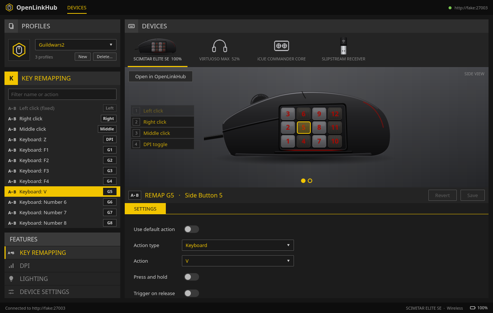
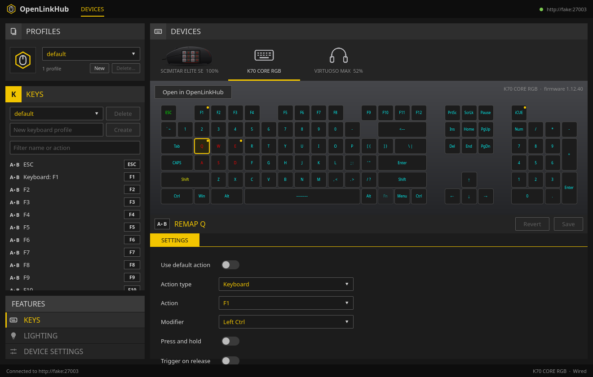
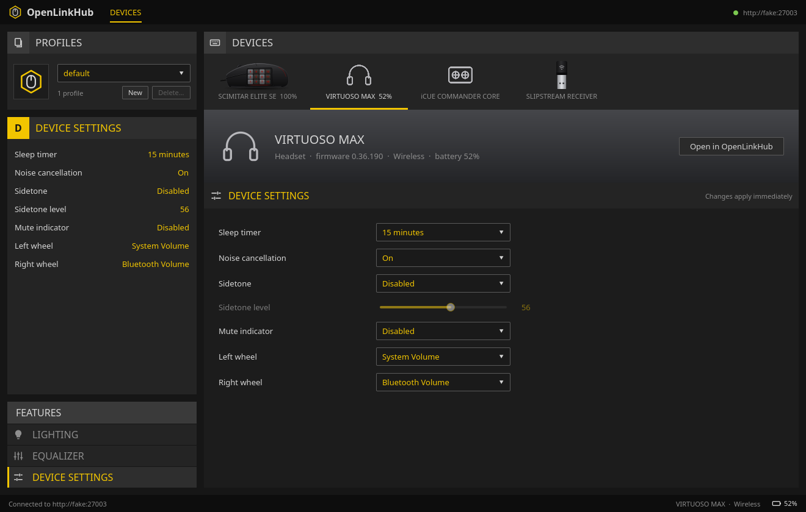
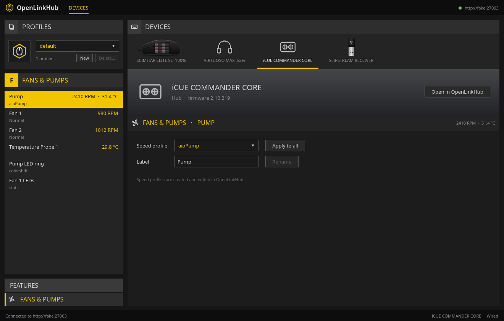
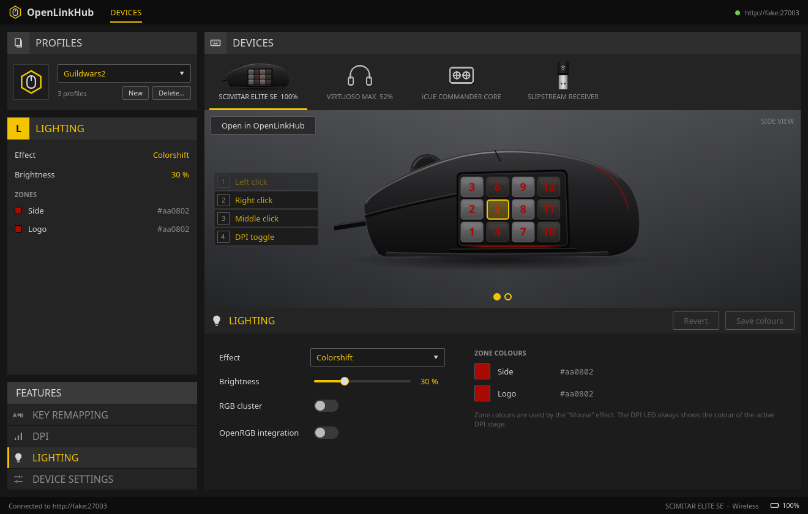
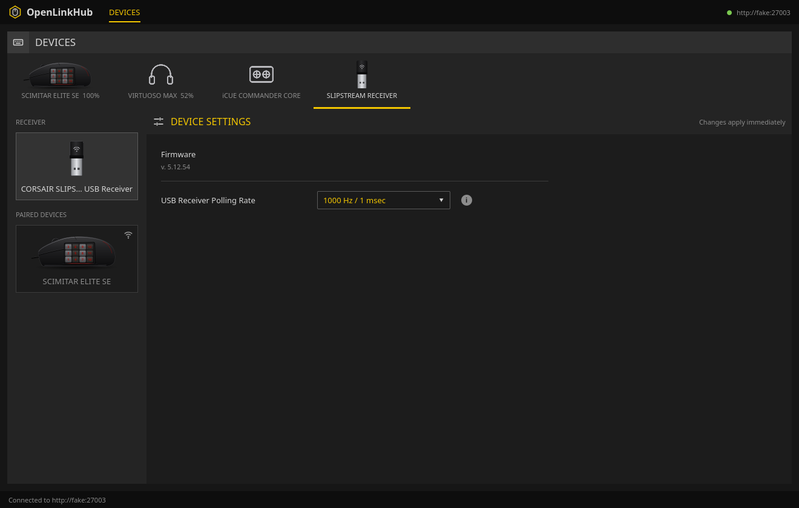
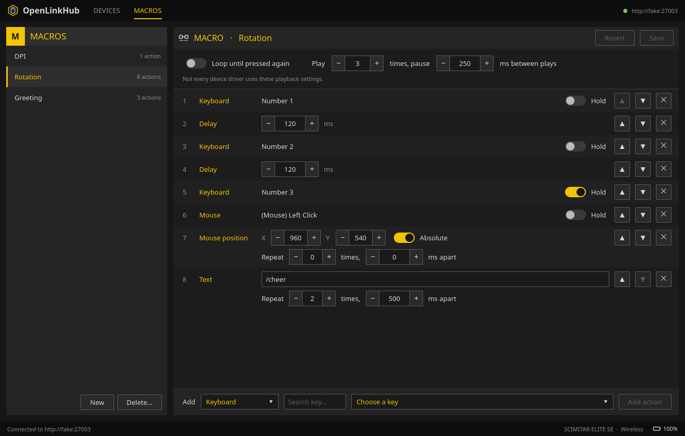

# OpenLinkHub Client
NOTE! This is fully created with Claude, I only tested the devices I use myself, please report any issues for other devices or just to report if it works for your devices. Also make sure you also test in OpenLinkHub itself to confirm if its client side (this repo) or api side (OpenlinkHub). Feel free to create merge request to add more device images for other mouses.

Claude's readme:

A desktop client for [OpenLinkHub](https://github.com/jurkovic-nikola/OpenLinkHub), the open source
Linux service for Corsair devices. It gives OpenLinkHub an iCUE-style interface: device artwork
with clickable buttons, an action list and a settings panel.

It works with every device OpenLinkHub supports: mice, keyboards, headsets, controllers, fan and
LED hubs, AIO coolers and more. Like OpenLinkHub's own pages, it shows what each device offers,
read from the device data. Devices with artwork (the Scimitar family, for now) get clickable
buttons on a picture of the device; everything else gets the same controls without the picture.

For Corsair devices the client only talks to OpenLinkHub's HTTP API. It needs no USB access or
root rights, and OpenLinkHub itself stays untouched.

The same interface also drives **non-Corsair devices**, which OpenLinkHub does not support, by
talking to them directly. That part is released on its own as **OpenDeviceHub** (and together with
the Corsair support as OpenLinkHub Client Plus; see [Editions](#editions)). Keychron keyboards are
the first non-Corsair devices it supports; more can be added (see
[Non-Corsair devices](#non-corsair-devices-opendevicehub)). Built with Python, PySide6 and QML.



> Not affiliated with or endorsed by Corsair. All artwork is original to this project.

## Features

What a device gets depends on what OpenLinkHub reports for it.

- **Key remapping** for mice, headsets, controllers and keyboards: keyboard keys, media keys,
  mouse buttons, macros, DPI and sniper actions, press-and-hold, trigger-on-release, and
  modifier keys on keyboards. On devices with artwork you pick the button on the picture.
- **Keyboards are drawn** from the key layout OpenLinkHub sends, with every key where
  OpenLinkHub's own keyboard page puts it and in its own colour; click a key to remap it.
- **Keyboard profiles**: the per-key layouts of a keyboard: switch, create, delete.
- **DPI**: stage values and stage colours.
- **Lighting**: effect, brightness (slider or steps, depending on the device), zone colours, RGB
  cluster and OpenRGB integration. Artwork shows the device in its own zone colours.
- **Effect settings**, under the effect in Lighting, Fans & pumps and RGB Cluster, like
  OpenLinkHub's RGB editor: the effect's colours (with a temperature each for the CPU/GPU/liquid
  temperature effects), speed, the probe temperature range, gradient colours, and the
  Slipstream-only direction and alternate colours.
- **Fans & pumps** on hubs and AIO coolers: live speed and temperature per channel, speed profile
  and lighting effect per channel (or for all at once), channel labels, RGB cluster.
- **Equalizer** for headsets.
- **Device settings**, each shown when the device has it: polling rate, lift-off distance,
  surface, sleep timer, angle snapping, button response, motion sync, ripple control,
  left-handed mode, noise cancellation, sidetone and its level, mute indicator, headset wheels,
  debounce time, keyboard layout, automatic brightness and controller vibration.
- **User profiles**: switch the active OpenLinkHub profile, create one from the current settings,
  delete one.
- **Macros**: the MACROS tab lists OpenLinkHub's macros: create, delete and edit them. A macro
  is a list of keyboard keys, mouse buttons, delays, typed text and mouse moves, in the order
  they play; keys can be held, text and mouse moves repeated, and the whole macro played several
  times or looped until its button is pressed again. Assign it to a button with Key remapping.
- **Slipstream receiver**: the USB dongle gets its own page, like the receiver card in iCUE's
  Device Settings. It shows the firmware, the paired devices and the USB receiver polling rate,
  which applies to every device on the dongle.
- **Open in OpenLinkHub**: every device page links to OpenLinkHub's own page for the device, for
  what the client does not cover.
- **Login** for OpenLinkHub instances with dashboard authentication enabled.
- **Tray icon**: closing the window hides it to the system tray; right-click the icon for
  Show, Check for Updates and Quit, or click it to show or hide the window. Without a system tray,
  closing the window quits. The tray menu and tooltip show the battery level of every device that
  reports one, and a notification tells when a battery drops to 15% or lower.
- **Non-Corsair devices** (OpenDeviceHub and OpenLinkHub Client Plus): the client drives these
  itself; OpenLinkHub has no part in it. The first are Keychron keyboards (V3 Ultra 8K): remap keys and the knob on every layer, lighting
  effect, brightness, speed and colour, USB and 2.4 GHz polling rate, debounce and the idle and
  sleep timers. See [Non-Corsair devices](#non-corsair-devices-opendevicehub).
- **Updates**: at startup the client checks GitHub for a new release. The Flatpak downloads and
  installs it and restarts; other installs get a link to the release page.

| Keyboard | Headset |
|---|---|
|  |  |
| **Fans & pumps** | **Lighting** |
|  |  |
| **Slipstream receiver** | **Macros** |
|  |  |

## Supported Corsair devices

Every device OpenLinkHub lists, recognised by the kind OpenLinkHub gives it (mouse, keyboard,
headset, controller, hub, AIO cooler, mousepad, memory, PSU, display, ...). Devices whose data
OpenLinkHub cannot send (some wireless dongles) still get a page with the "Open in OpenLinkHub"
link.

Devices with artwork and clickable buttons:

| Module | Device (USB product id) |
|---|---|
| `scimitar-elite` | Scimitar Elite (7139) |
| `scimitar-rgb-elite` | Scimitar RGB Elite (7051) |
| `scimitar-pro-rgb` | Scimitar Pro RGB (6974) |
| `scimitar-rgb` | Scimitar RGB (6942) |
| `scimitar-elite-wireless` | Scimitar Elite Wireless, over the cable and the Slipstream dongle (7131) |
| `scimitar-elite-se` | Scimitar Elite Wireless SE, over the cable and the Slipstream dongle (11042) |

Slipstream receivers (`SLIPSTREAM` and `SLIPSTREAM V2`) are listed as their own device.
Adding artwork for a device is a layout file and an SVG; see [Adding a device](#adding-a-device).

## Non-Corsair devices (OpenDeviceHub)

OpenDeviceHub is the part of the client for devices that are not Corsair's, and so not driven by
OpenLinkHub. It talks to each device directly, using the device's own protocol, and needs no
background service. It has the same interface as the Corsair side: a drawn keyboard, a key list
and editors for keys, lighting and settings.

Supported so far:

| Vendor | Devices |
|---|---|
| Keychron | V3 Ultra 8K keyboards (ANSI, ISO, JIS), by cable or the Ultra-Link 8K receiver; see [Keychron keyboards](#keychron-keyboards) |
| Gigabyte | Graphics cards with RGB Fusion 2 lighting (AORUS, GAMING OC, EAGLE…, GeForce and Radeon); see [Graphics cards](#graphics-cards) |

Devices with an open protocol or open source firmware are the easiest to add; requests and pull
requests for other vendors are welcome. Each vendor gets its own package next to
`src/olhclient/keychron/` and a session with the QML API of `DeviceSession` (see
[How it works](#how-it-works)).

### Keychron keyboards

Keychron's "Ultra 8K" keyboards run Keychron's fork of the open source
[ZMK firmware](https://github.com/Keychron/zmk) (branch `rtl8762g`). Its raw HID interface speaks
the VIA protocol (keymap, knob, lighting) plus a few Keychron commands (polling rate, debounce,
idle and sleep timers), the same as [Keychron Launcher](https://launcher.keychron.com). The client
itself speaks this protocol to the keyboard. OpenLinkHub does not support Keychron keyboards and
plays no part here; in OpenLinkHub Client Plus it is only used for the Corsair devices.

| Keyboard | USB product id |
|---|---|
| Keychron V3 Ultra 8K ANSI | 3434:0c30 |
| Keychron V3 Ultra 8K ISO | 3434:0c31 |
| Keychron V3 Ultra 8K JIS | 3434:0c32 |
| Keychron Ultra-Link 8K 2.4 GHz receiver, with one of the above | 3434:d028 |

Connect the keyboard with the USB cable or the Ultra-Link 8K receiver; Bluetooth is not supported.
The receiver does not say which keyboard it serves, so the client tells the model apart by which
matrix positions hold keys (ANSI, ISO and JIS differ). A keyboard that sleeps behind the receiver
shows as offline until it wakes up.

Opening `/dev/hidraw*` needs a udev rule (Keychron Launcher in the browser needs the same):

```sh
sudo cp udev/70-keychron-hidraw.rules /etc/udev/rules.d/
sudo udevadm control --reload && sudo udevadm trigger
```

Then replug the keyboard. Other Ultra 8K boards use the same firmware and only need a board
definition in `src/olhclient/keychron/boards.py` (matrix size and key positions, from the board's
shield in Keychron/zmk).

### Graphics cards

Gigabyte cards with RGB Fusion 2 lighting have a lighting controller on one of the card's I2C
buses. The client drives it the way [OpenRGB](https://gitlab.com/CalcProgrammer1/OpenRGB) does
(`Controllers/GigabyteRGBFusion2GPUController`, ported to `src/olhclient/gpu/`), without needing
OpenRGB. `gpu/cards.py` holds OpenRGB's list of the 103 cards it knows, by PCI id. Tested on the
AORUS Radeon RX 9070 XT Elite.

Lighting has nine modes (static, pulse, flash, double flash, colour cycle, gradient, wave, colour
shift, tricolour), brightness, speed and a colour for each of the five zones. A change applies at
once but lasts only until the computer is switched off; **Save to card** stores it on the card. The
card cannot report its lighting, so the client shows what it last set (kept in
`~/.local/state/olh-client/gpu-lighting.json`) and does not change the card until you do.

The client looks for cards once, at startup. That needs the `i2c-dev` module and access to
`/dev/i2c-*`, the same as OpenRGB:

```sh
echo i2c-dev | sudo tee /etc/modules-load.d/i2c-dev.conf && sudo modprobe i2c-dev
```

For access, either install OpenRGB's udev rules (`60-openrgb.rules`, which give the logged-in user
`/dev/i2c-*`), or use the `i2c` group of i2c-tools' rule (`45-i2c-tools.rules`):
`sudo usermod -aG i2c "$USER"` and log in again. Other cards with this controller only need an entry in `gpu/cards.py`
(OpenRGB's detector list has the PCI ids and the address).

## Requirements

- Linux
- For Corsair devices (OpenLinkHub Client and Plus): a running
  [OpenLinkHub](https://github.com/jurkovic-nikola/OpenLinkHub), by default on
  `http://127.0.0.1:27003`. OpenDeviceHub does not need it.
- Python 3.11 or newer
- PySide6 6.8 or newer and httpx

## Installation

### Editions

The same code is released as three apps. Pick the one for the devices you have; they install side
by side.

| App | For | Bundle | App id |
|---|---|---|---|
| **OpenLinkHub Client** | Corsair devices through OpenLinkHub | `OpenLinkHub-Client-vX.Y.Z.flatpak` | `io.github.mdmatthias.OpenLinkHub-Client` |
| **OpenLinkHub Client Plus** | Corsair devices through OpenLinkHub, and non-Corsair devices | `OpenLinkHub-Client-Plus-vX.Y.Z.flatpak` | `io.github.mdmatthias.OpenLinkHub-Client-Plus` |
| **OpenDeviceHub** | Non-Corsair devices only (so far Keychron keyboards and Gigabyte graphics cards); no OpenLinkHub needed | `OpenDeviceHub-vX.Y.Z.flatpak` | `io.github.mdmatthias.OpenDeviceHub` |

OpenLinkHub Client needs no device access at all. The other two talk to non-Corsair devices
directly (Keychron keyboards over `/dev/hidraw*`, graphics cards over `/dev/i2c-*`), so their
Flatpaks have `--device=all` (Flatpak has no narrower permission for it); Keychron keyboards need
the [udev rule](#keychron-keyboards), graphics cards [the i2c group](#graphics-cards). From source, `--edition openlinkhub|plus|devices`
picks one; the default is everything (`plus`).

### Flatpak (recommended)

Download the bundle of your edition from
[Releases](https://github.com/mdmatthias/OpenLinkHub-Client/releases), then, for example:

```sh
flatpak install --user OpenLinkHub-Client-vX.Y.Z.flatpak -y
flatpak run io.github.mdmatthias.OpenLinkHub-Client
```

Flatpak pulls the KDE runtime and the PySide base app from Flathub. Later versions install
themselves from within the app (see Updates above); each edition updates to its own bundle. A
Flatpak reads its config from `~/.var/app/<app id>/config/olh-client/config.toml`; the two
OpenLinkHub editions can read OpenLinkHub's certificate in `/opt/OpenLinkHub/certificates`.

### From source

Clone the repository and install it in a virtual environment.

With [uv](https://docs.astral.sh/uv/) and PySide6 from PyPI:

```sh
uv sync
uv run olh-client
```

With pip:

```sh
python -m venv .venv
.venv/bin/pip install -e .
.venv/bin/olh-client
```

With your distribution's PySide6 (on Arch: `pyside6` and `python-httpx`):

```sh
uv venv --system-site-packages --python /usr/bin/python3
uv pip install --python .venv/bin/python -e . --no-deps
.venv/bin/olh-client             # or: .venv/bin/python -m olhclient
```

## Usage

```
olh-client [--url URL] [--config FILE] [--insecure] [--debug] [--version]
```

| Option | Meaning |
|---|---|
| `--url` | OpenLinkHub base URL. Overrides the config file. |
| `--config` | Config file to use instead of `~/.config/olh-client/config.toml`. |
| `--insecure` | Do not verify OpenLinkHub's TLS certificate (it is self-signed). |
| `--debug` | Debug logging. |

The client polls OpenLinkHub every few seconds, so devices that are plugged in, switched on or
reconnected show up by themselves. Key assignments, DPI stages, zone colours and the equalizer
have a Save button; everything else applies immediately.

### Configuration

All settings are optional. They live in `~/.config/olh-client/config.toml`
(`$XDG_CONFIG_HOME` is honoured):

```toml
base_url = "http://127.0.0.1:27003"
poll_interval = 5            # seconds
check_updates = true         # look for a new release at startup

# Only needed when OpenLinkHub's dashboard authentication is enabled (HTTPS):
# origin   = "https://127.0.0.1:27003"   # must equal authOrigin in dashboard.json
# ca_file  = "/opt/OpenLinkHub/certificates/server.crt"
# username = "admin"
```

When OpenLinkHub asks for a login, the client shows a login dialog. The session is kept in
memory only; no password is stored.

## Known limitations

- **Tested hardware**: the client is used with a Scimitar Elite Wireless SE, a Virtuoso Max
  headset and a Slipstream receiver. Keyboards, hubs and AIO coolers are built from OpenLinkHub's
  source and tested against fixtures only; please report what does not work.
- **A setting can be refused**: OpenLinkHub sometimes lists options for a setting the device's
  driver cannot change. The client then shows OpenLinkHub's error and the real value again.
- **Not covered** (use "Open in OpenLinkHub"): LCD and Xeneon screens, per-key and per-area
  colours, hub strip and adapter setup, mouse gestures, editing speed profiles, manual fan speed.
- **Hub lighting**: OpenLinkHub does not say which hub channels have LEDs (except on the
  Commander Core), so every channel offers a lighting effect.
- **Lighting preview** on artwork: it shows the zone colours, which is what a mouse shows in the
  `mouse` effect. Animated effects are not previewed, brightness only matters when it is 0
  (shown as unlit), and the Scroll and Front zones of the wired Scimitars are not drawn.
- **Slipstream receiver**: OpenLinkHub versions before the fix cannot return a receiver as JSON
  (`GET /api/devices/{serial}` answers with an empty body). On those the client reads its state
  from the dashboard page `/device/{serial}`, so it depends on that page's layout. The polling
  rate can only be changed on receivers whose OpenLinkHub driver supports it (product ids 7132,
  11008 and 11035 at the time of writing); other receivers refuse the change. OpenLinkHub answers
  "OK" as soon as it has sent the command and does not check that the receiver took it, so neither
  can the client. A receiver that takes the change restarts: its devices drop out and OpenLinkHub
  lists it again about 9 seconds later. A Slipstream receiver (product id 11008) once got into a
  state where it ignored most changes; unplugging and replugging it fixed that.
- The top view still draws a cable for the wireless Scimitars.
- **Keychron keyboards**: written from Keychron's firmware source and tested against an emulation
  of it. Reading was checked on a V3 Ultra 8K ANSI (firmware v1.0.3) over the 2.4 GHz receiver;
  writing keys, lighting and settings has not been tried on a real keyboard yet. Not covered:
  Bluetooth, macros stored on the keyboard, per-key colours, resetting the keymap. The JIS key positions use
  the common JIS key sizes and may be off by a little. Settings are read again on every poll, so
  changes made with Fn shortcuts show up; the keymap is read once when the keyboard is opened.

## How it works

```
src/olhclient/
  api/        ApiClient (httpx), typed models of the device JSON, Slipstream page parser
  core/       Worker (thread pool), Backend (polling, device list), DeviceSession and
              ReceiverSession, feature controllers (core/features/*), MacroLibrary (macros page),
              artwork lighting
  devices/    device modules: base.py, registry.py, generic/, scimitar/
  keychron/   Keychron keyboards over raw HID: hidraw access, protocol, keycodes, boards
  gpu/        graphics card lighting over I2C: i2c-dev access, RGB Fusion 2 protocol, card list
  qml/        Main.qml, theme/, components/, layout/, features/
```

Devices are listed from `GET /api/`, which gives every device's kind (from the icon OpenLinkHub
uses for it). The device JSON (`GET /api/devices/{serial}`) is parsed into a `DeviceState` whose
parts are all optional: lighting, key assignments, DPI stages, hub channels, keyboard keys,
equalizer. Each **feature** (a controller plus a list and an editor panel in QML) has a
`supports(state)` check, so a device shows exactly the features its data offers. Simple settings
come from one table (`core/features/settings.py`): OpenLinkHub pairs an options map in the device
JSON (`SleepModes`) with the current value in `DeviceProfile` (`SleepMode`), and writes go to
`/api/<kind>/<setting>`.

Keyboards need no artwork: `api/keyboard_grid.py` ports the CSS grid OpenLinkHub's keyboard page
uses (`UIKeyboardRow` columns, keys spanning cells, ISO Enter, LED bars) and places every key of
the device's layout the way that page does. It was checked key by key against OpenLinkHub's page
for all 74 layouts it ships; only a few decorative LED bars that the page positions on their own are
left out (they are colour-only and cannot be remapped).

A **device module** is optional. It adds artwork, hotspots and button labels, which buttons
cannot be remapped (`locked_buttons`) and which buttons OpenLinkHub reports but the model does not
have (`missing_buttons`, e.g. the profile switch on the wireless Scimitars). It can also limit the
features and settings. Devices without a module use the generic one: no artwork, every feature
the data offers.

API calls run on a thread pool; results come back on the GUI thread. After every write the
client reloads the device, so the UI always shows what OpenLinkHub really stored.

Keychron keyboards have nothing to do with OpenLinkHub, which does not support them; the client
drives them itself. `keychron/hidraw.py` finds them in sysfs
(`/sys/class/hidraw`, vendor 3434, the VIA usage page 0xFF60 in the report descriptor) and reads
and writes `/dev/hidrawN` directly, so no native HID library is needed. `keychron/protocol.py`
sends 32-byte reports; the keyboard answers each with the same report, values filled in.
`core/keychron.py` has a `KeychronSession` with the QML API of `DeviceSession`, so the main window,
the keyboard view and the lighting and settings panels work unchanged; its controllers are in
`core/features/keychron.py`. Every write (a key, a lighting value, a setting) is stored on the
keyboard at once, as Keychron Launcher does.

Graphics cards are driven the same way. `gpu/i2c.py` lists the I2C buses in sysfs with the PCI
ids of the device each belongs to, and `gpu/device.py` probes the known cards' controller address
(on AMD cards only on the "OEM" bus, as OpenRGB does). `gpu/fusion2.py` turns a `Lighting` into
8-byte writes. `core/gpu.py` has a `GpuSession`, again with the QML API of `DeviceSession`; its
lighting controller is in `core/features/gpu.py`, its editor in `qml/features/GpuLightingEditor.qml`.

### Adding a device

A device works without a module; a module adds artwork.

1. Create a package `src/olhclient/devices/<family>/` that exposes `MODULES`, a list of
   `DeviceModule` instances. Implement `match_score(device_json)`, usually by checking
   `ProductId` and `Template` from `GET /api/devices/{serial}`.
2. Add a `layout.json` with one entry per view. Each view has an image and hotspots. Hotspot
   rects are in the image's pixel space (`size`), and each hotspot is keyed by the button
   **name** OpenLinkHub reports in `KeyAssignment`. `button_list` names the buttons listed next
   to the artwork; `keypad` holds the rows of a button grid (e.g. G1–G12), which are reached
   through their hotspots.
3. Put the artwork in `assets/`. A `side.png` next to `side.svg` is used instead of the SVG, and
   `assets/<module id>/` overrides the shared images, which is where real renders go. In SVG
   artwork, elements with `class="zone-<zone>"` (e.g. `zone-side`, `zone-logo`) take the colour
   of that lighting zone, and elements with `class="button-<button>"` (e.g.
   `button-profile-switch`) are dropped for models listing that button in `missing_buttons`.
   Artwork must stay within SVG Tiny 1.2, which is what Qt renders.
4. Optionally limit `features` and `settings` (keys from `core/features/settings.py`) to what the
   hardware really supports; by default the device data decides.

The registry discovers modules automatically. Modules can also ship in another Python package
through the `olhclient.devices` entry-point group.

### Adding a feature

1. Add a member to `Feature` in `devices/features.py`.
2. Write a controller in `core/features/` with a `supports(state)` check and register it in
   `CONTROLLERS`.
3. Write its list and editor QML in `qml/features/`.
4. A module can replace the generic editor by returning a QML file from `qml_override(feature)`.

## Development

```sh
uv sync --extra dev
uv run pytest              # or .venv/bin/python -m pytest with a system PySide6
```

With a distribution PySide6, also install `python-pytest-qt` and `python-respx`.

The tests run against an in-memory fake of the API. The QML smoke tests load the real UI on the
`offscreen` platform, open every feature on every kind of device, and fail on any QML warning.
Fixtures in `tests/fixtures/`, with serials and paths anonymised:
- captured from real devices: Scimitar Elite SE, Virtuoso Max headset, Slipstream receiver
  (paired device trimmed), `GET /api/`;
- derived: the legacy Scimitar (bitmasks of the `scimitarrgbelite` driver);
- built from OpenLinkHub's driver structs: Commander Core, iCUE Link hub, K70 Core keyboard, and
  the Slipstream page (`web/slipstream.html`, for older OpenLinkHub versions);
- copied from OpenLinkHub: three keyboard layouts, with where its page draws each key
  (`tests/fixtures/keyboards/`).

### Flatpak and releases

The Flatpak files live in `flatpak/`, one manifest, desktop file and metainfo per
[edition](#editions) (`<app id>.yaml`, ...; the editions are defined in `src/olhclient/edition.py`).
The manifests use the KDE runtime with the `io.qt.PySide.BaseApp` base app and the httpx wheels in
`python-dependencies.json` (keep it in sync with `pyproject.toml`). They are identical except for
the app id and the permissions; `tests/test_edition.py` checks that. The release notes are written
once, in `io.github.mdmatthias.OpenLinkHub-Client.metainfo.xml`; `flatpak/copy_releases.py` copies
them into the other two apps' metainfo at build time.

```sh
flatpak/build-and-run.sh [edition]   # build, install (--user) and run this checkout
flatpak/build-bundle.sh [edition]    # build <bundle>-v<version>.flatpak
```

`edition` is `openlinkhub` (default), `plus` or `devices`.

To release: bump `__version__` in `src/olhclient/__init__.py`, add a `<release>` with its notes to
`io.github.mdmatthias.OpenLinkHub-Client.metainfo.xml`, commit, and push a tag `v<version>`. The
workflow in `.github/workflows/flatpak.yml` checks that the tag, `__version__` and the metainfo
agree, builds the three bundles and attaches them to one GitHub release whose description is that
`<release>` entry (converted by `.github/scripts/release_notes.py`). Tags ending in `-dev` become
prereleases, which the updater skips. The updater (`update.py`, `core/updater.py`) looks for its
own edition's asset, `<bundle>-<tag>.flatpak`.

### Notes on the OpenLinkHub API

- Errors come back as HTTP 200 with `"status": 0` and a `message`.
- `GET /api/devices/{serial}` always has `status` 0. Success means a `device` key is present.
- `GET /api/` lists every device with its kind icon (`Image`); `GET /api/devices` redirects to
  `/api/devices/`, which leaves the kind out.
- A device's data does not prove its driver implements a setting; writes can come back with
  `status` 0 even when the options are listed.
- Keyboards use the same key assignment handler as mice (`/api/keyboard/updateKeyAssignment`),
  with an extra modifier key. Their JSON has no `InputActions`, so the client looks action names
  up in `/api/input/*`.
- `GET /api/temperatures/` (speed profiles) answers with `status` 0 on success.
- Key indexes are bitmasks that differ between Scimitar generations. Button names do not, which
  is why layouts are keyed by name.
- `POST /api/mouse/dpi` answers with an error when nothing changed, so the client only sends
  stages that differ. Colours (DPI and zones) are only sent for stages and zones that changed.
- Zone colours are only used by the `mouse` effect. The DPI LED always shows the colour of the
  active stage.
- Effect settings (`GET /api/color/profile/{serial}/{effect}`, saved with `PUT /api/color/change`)
  belong to the device, not to a channel or zone. The drivers replace colours, speed and gradients
  on every save (the Slipstream ones also direction and alternate colours), so the client sends
  every setting back, changed or not.
- Which device settings appear follows the OpenLinkHub web UI: the polling rate only when the
  driver lists `PollingRates` (not for a mouse on the Slipstream dongle; the receiver has its own
  polling rate), the sleep timer only for wireless models on the dongle. The polling rate
  "Not Set" (0) is left out because the server refuses it.
- The receiver's polling rate is set with `POST /api/mouse/pollingRate` and the receiver's serial.
- Macros: `/api/macro/newValue` gives a new action the index `len(actions)`, and drivers play
  indexes 0 up to that length, skipping missing ones. Deleting an action other than the last
  therefore leaves a gap: the actions after it never play and the next new action overwrites
  the last one. The client never deletes in the middle: it deletes every action from the first
  change on and adds them again in their new order. `updateValue` only changes hold, repeat and
  mouse position, and refuses a macro whose keys would all be held. Macro names follow the
  profile name rules and must be unique ignoring case (the file is `<lowercase name>.json`).
- User profile names must be letters and numbers only. The active and the `default` profile
  cannot be deleted. Creating a profile copies the current settings; it does not switch to it.

## Licence

[GPL-3.0](LICENSE), the same as OpenLinkHub. The artwork in `src/olhclient/devices/*/assets` and
`src/olhclient/qml` is original to this project. Corsair, iCUE, Scimitar and Slipstream are
trademarks of Corsair. This project is not affiliated with or endorsed by Corsair.
